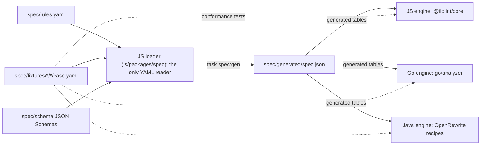
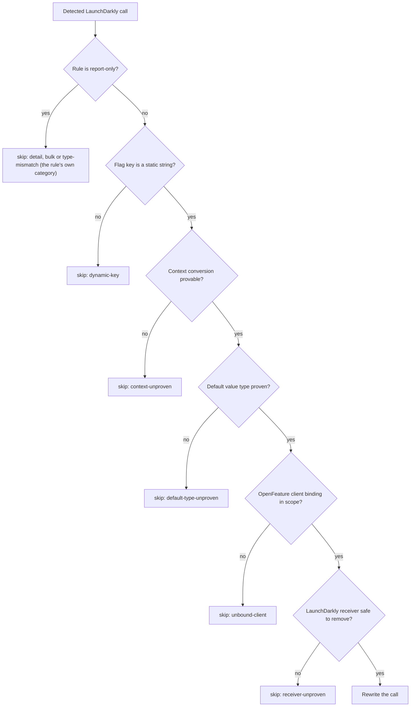

# fldlint

fldlint finds LaunchDarkly server-SDK flag evaluations in JavaScript/TypeScript,
Go and Java, and migrates the ones it can prove safe to OpenFeature. Calls it
cannot prove safe are reported with a skip category and left alone.

> Status: **not released.** The repository is public, but there are no releases
> and no tags, and nothing is published to npm, Maven Central or the Go module
> proxy. Use it from a checkout of this repository.

**This is a separate project from [flaglint](https://github.com/flaglint)
(similar name).** It is derived in part from flaglint-js and flaglint-go under
the MIT license; see [NOTICE](NOTICE) and [ADR 005](docs/adr/005-attribution-and-porting-policy.md).
It is not affiliated with or endorsed by the flaglint project.

LaunchDarkly is a trademark of its owner. fldlint is an independent project
and is not affiliated with, sponsored by or endorsed by LaunchDarkly or the
OpenFeature project.

## What works today

| Ecosystem | Tool | Details |
|-----------|------|---------|
| JS/TS | ESLint plugin `eslint-plugin-fldlint` (runs through `eslint`, fixes with `--fix`) and an `npx codemod` package `@fldlint/codemod`, both over the shared planner `@fldlint/core`. | [plugin](js/packages/eslint-plugin/README.md), [codemod](js/packages/codemod/README.md). There is no fldlint CLI: `@fldlint/cli` is an unimplemented placeholder. |
| Go | `go/analysis` analyzer with suggested fixes, as the `fldlint` binary (standalone), the `fldlint-fix` binary (`go vet -vettool`, `go fix -fixtool`), a golangci-lint module plugin (`go/golangci`) and the optional `fldlint-sarif` converter. go-server-sdk v7 only. | [go/README.md](go/README.md) (commands, observed exit codes) |
| Java | OpenRewrite recipes that rewrite `boolVariation`, `stringVariation`, `doubleVariation` and `intVariation`, plus a search recipe that reports everything else. | [java/README.md](java/README.md) |

Nothing is published: every npm package is `private`, and the Java artifact and
Go module have no release. Each ecosystem has its own detection engine; they
share data, not code ([ADR 002](docs/adr/002-spec-as-data-not-shared-engine.md)),
and each tool follows its ecosystem's conventions
([ADR 008](docs/adr/008-idiomatic-per-ecosystem.md)), so exit codes differ
([exit-codes.md](spec/contracts/exit-codes.md)).

## What gets rewritten

The rewriting rules are in [`spec/rules.yaml`](spec/rules.yaml). The OpenFeature
call takes the arguments in a different order, so the rewrite reorders them:

```text
LaunchDarkly:  client.boolVariation(key, context, default)
OpenFeature:   ofClient.getBooleanValue(key, default, context)
```

| Rule | JS/TS | Go | Java |
|------|-------|----|------|
| `bool-variation` | `boolVariation` to `getBooleanValue` | `BoolVariation`, `BoolVariationCtx` to `BooleanValue` | `boolVariation` to `getBooleanValue(..).booleanValue()` |
| `string-variation` | `stringVariation` to `getStringValue` | `StringVariation`, `StringVariationCtx` to `StringValue` | `stringVariation` to `getStringValue` |
| `number-variation` | `numberVariation` to `getNumberValue` | `Float64Variation`, `Float64VariationCtx` to `FloatValue` | `doubleVariation` to `getDoubleValue(..).doubleValue()` |
| `java-int-variation` | none | none | `intVariation` to `getIntegerValue(..).intValue()` |
| `json-variation` | `jsonVariation` to `getObjectValue` | none | none |

What happens to the context argument
([placeholders.md](spec/contracts/placeholders.md), [ADR 006](docs/adr/006-context-conversion-skipped-unless-provable.md)):
it is converted only when it is a simple single-kind literal; anything else is
`context-unproven` and the call is not edited.

- JS/TS: `{ key: x }` or `{ kind: "user", key: x }` becomes `{ targetingKey: x }`.
- Go: `ldcontext.New(x)` becomes `openfeature.NewEvaluationContext(x, nil)`, and
  the OpenFeature call gets a leading `context.Context`: for `*Ctx` methods, the
  call's own first argument; for the plain methods, the enclosing function's
  only `context.Context` parameter, else `context.TODO()`.
- Java: `LDContext.create(x)` becomes `new ImmutableContext(x)`.

The call is replaced by a call on the OpenFeature client that is already in
scope; fldlint never creates a client and never deletes the LaunchDarkly client
declaration ([ADR 010](docs/adr/010-planner-step-order-and-receiver-removal.md)).
The reordering means a side effect in the default or in the context key runs in
a different order after the rewrite (known and accepted, see placeholders.md).

Report-only (always reported, never edited): `*Variation*Detail` calls
(`detail`), `allFlagsState` (`bulk`), and `variation`, `migrationVariation`,
Go `IntVariation` and `JSONVariation`, Java `jsonValueVariation`
(`type-mismatch`).

## Examples

Every example is a shared fixture under
[`spec/fixtures/bool-variation/`](spec/fixtures/bool-variation/), run with the
tool from this checkout. The setup for each command is in
[docs/walkthroughs.md](docs/walkthroughs.md). Positions are `line:column`.

### JS/TS

Fixture `aliased-import/js/input.ts` and `output.ts`:

```ts
// before
return await ldClient.boolVariation("dark-mode", { kind: "user", key: userKey }, false);
// after
return await client.getBooleanValue("dark-mode", false, { targetingKey: userKey });
```

`npx eslint src` (paths shortened), with `darkmode.ts` from fixture
`aliased-import` and `feature.ts` from fixture `dynamic-key` (exit 0: the preset sets `warn`, and warnings do not fail ESLint):

```text
src/darkmode.ts
  8:16  warning  Migrate boolean flag "dark-mode" to OpenFeature  fldlint/bool-variation

src/feature.ts
  8:16  warning  Flag key is not a static string [skip: dynamic-key]  fldlint/bool-variation

✖ 2 problems (0 errors, 2 warnings)
  0 errors and 1 warning potentially fixable with the `--fix` option.
```

`npx eslint --max-warnings 0 src` exits 1; `npx eslint --fix src/darkmode.ts`
exits 0 and produces the `after` above. The skipped call has no fix.

### Go

Fixture `aliased-import/go/input.go` and `output.go.golden`:

```go
// before
on, _ := ldClient.BoolVariation("dark-mode", ldcontext.New("user"), false)
// after (adds the "context" import, drops the unused ldcontext import)
on, _ := client.BooleanValue(context.TODO(), "dark-mode", false, openfeature.NewEvaluationContext("user", nil))
```

`fldlint ./flags ./skips` (paths shortened) on that file plus fixture
`dynamic-key/go/input.go`, against the SDK stubs in `go/analyzer/testdata`. It exits **3** because there are
findings (Go framework exit codes; see [go/README.md](go/README.md)):

```text
flags/input.go:21:11: Migrate boolean flag "dark-mode" to OpenFeature
skips/input.go:14:11: Flag key is not a static string [skip: dynamic-key]
```

`fldlint -fix ./flags` exits 0 and writes exactly the golden file.

### Java

Fixture `aliased-import/java/Before.java` and `After.java`:

```java
// before
return ldClient.boolVariation("new-checkout", create(userKey), false);
// after
return client.getBooleanValue("new-checkout", false, new ImmutableContext(userKey)).booleanValue();
```

The smoke project [`java/smoke`](java/smoke/README.md) runs the recipes through
`rewrite-maven-plugin` 6.46.1 `dryRun` (commands in
[docs/walkthroughs.md](docs/walkthroughs.md)). It exits 0 with `BUILD SUCCESS`
even though it would change files; add `-DfailOnDryRunResults=true` to make it
exit 1. The patch it writes (identical to
[`java/smoke/expected.patch`](java/smoke/expected.patch)) contains a rewrite
and, from the search recipe, a skip marker:

```diff
-        boolean on = ld.boolVariation("smoke-bool", LDContext.create(userKey), false);
+        boolean on = client.getBooleanValue("smoke-bool", false, new ImmutableContext(userKey)).booleanValue();
...
-        boolean dynamic = ld.boolVariation(dynamicKey, LDContext.create(userKey), false);
+        boolean dynamic = /*~~(Flag key is not a static string [skip: dynamic-key])~~>*/ld.boolVariation(dynamicKey, LDContext.create(userKey), false);
```

The marker is a comment only; the call itself is unchanged.

### Codemod (JS/TS)

`npx codemod@1.18.7 workflow run -w js/packages/codemod -t <target> --no-interactive`
rewrote `darkmode.ts` as above and printed the skip (exit 0; the codemod exits 0
even when it skips, so read its output):

```text
src/feature.ts
  src/feature.ts:8:16  bool-variation  Flag key is not a static string [skip: dynamic-key]
```

## How it works



The loader validates the rules and fixtures and writes `spec.json`, which is
committed, along with generated rule tables for each engine (`rules.gen.ts`,
`rules_gen.go`, `RulesGen.java`). Go and Java contain no YAML code
([ADR 011](docs/adr/011-parse-yaml-once-emit-canonical-json.md)). The engines
share data, not code ([ADR 002](docs/adr/002-spec-as-data-not-shared-engine.md)).
Edit the YAML, run `task spec:gen`, commit the output; `task spec:check` fails
on drift.

Every engine decides each detected call with the same fixed step order, first
match wins ([ADR 010](docs/adr/010-planner-step-order-and-receiver-removal.md),
skip categories in `spec/rules.yaml`):



A skipped call is reported and not edited. The same step order does not always
give the same outcome in every language, because the facts differ: a
function-local client whose only use is the rewritten call is rewritten in JS
but skipped as `receiver-unproven` in Go (fixture `stranded-local-client`).

## Try it from source

Requirements: Node `>=22.13`, the Go version in `go/go.mod`, and JDK 21 and
`unzip` for Java (`java/mvnw` needs it). Dev tasks run through [go-task](https://taskfile.dev); `task --list`
shows them (table in [CONTRIBUTING.md](CONTRIBUTING.md)).

- ESLint plugin: `cd js && npm ci && npm run build`, then in your project
  `npm install --save-dev eslint @typescript-eslint/parser <repo>/js/packages/eslint-plugin`
  and an `eslint.config.js` as in the [plugin README](js/packages/eslint-plugin/README.md).
- Codemod: `cd js && npm ci && npm run build -w @fldlint/codemod`, then
  `npx codemod@1.18.7 workflow run -w js/packages/codemod -t <target> --no-interactive`
  from the repository root. The target must be a clean Git tree or use `--allow-dirty`.
- Go: `cd go && go install ./cmd/fldlint ./cmd/fldlint-fix ./cmd/fldlint-sarif`,
  then `fldlint ./...` (see [go/README.md](go/README.md)).
- Java: `task java:test` (or `./mvnw -B verify` in `java/`) builds and tests;
  `task java:smoke` runs the recipes through `rewrite-maven-plugin` `dryRun`
  against `java/smoke`.

`task test` runs the JS, Go and Java tests. `task check` is the full local gate
(shared checks, Go, JS, and Java lint and tests). CI does not run it as one job:
on the Node 22 leg it runs `check:shared`, `check:go` and `check:js` per
changed area, and the Node 24 and 26 legs run `check:node`. Java runs in its own
non-required job. The required checks also include `dco`, CodeQL and dependency
review. `task spec:check` validates the spec and checks generated code for drift.

## Shared spec

[`spec/`](spec/) is the source of truth: `rules.yaml` (rule ids, messages,
per-language methods and templates, skip categories), JSON Schemas, fixtures
(`case.yaml` per case), and [contracts](spec/contracts/) for output format,
fingerprint, baseline, SARIF, placeholders and exit codes. Decisions are
recorded in [docs/adr/](docs/adr/).

## Contributing

See [CONTRIBUTING.md](CONTRIBUTING.md) (tasks, conventions, sign-off) and
[AGENTS.md](AGENTS.md) (rules for coding agents). Licensed under the
[MIT License](LICENSE); attribution is in [NOTICE](NOTICE).
