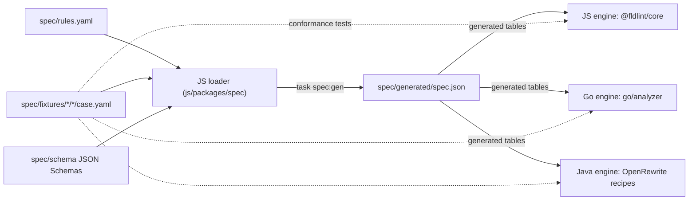
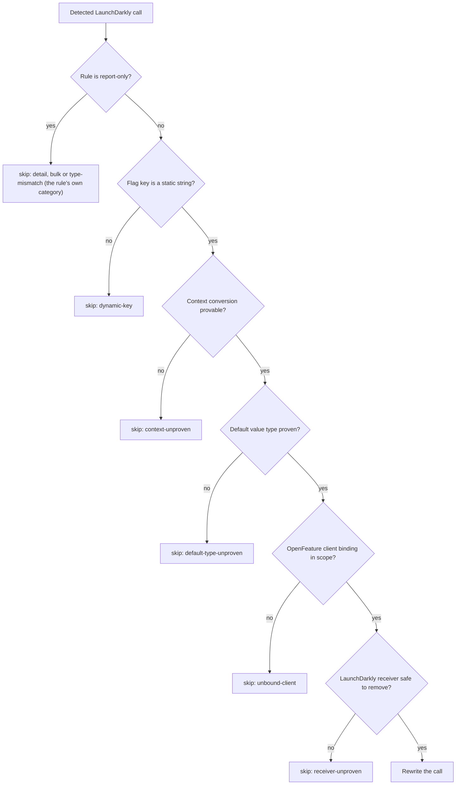

# fldlint

fldlint finds LaunchDarkly server-SDK flag evaluations in JavaScript/TypeScript,
Go and Java and rewrites them to OpenFeature when a fixed set of checks passes
(flag key, context, default type, client binding). Any other call is reported
with a skip category and left unchanged.

> Status: **not released.** No tags, no releases; nothing is on npm (every
> package is `private`), Maven Central or the Go module proxy. Use it from a
> checkout.

**Not [flaglint](https://github.com/flaglint).** fldlint is a separate project,
derived in part from flaglint-js and flaglint-go under the MIT license
([NOTICE](NOTICE), [ADR 005](docs/adr/005-attribution-and-porting-policy.md)),
and is not affiliated with or endorsed by the flaglint project.

## Tools

| Ecosystem | Ships as | Docs |
|-----------|----------|------|
| JS/TS | `eslint-plugin-fldlint` (ESLint, `--fix`) and `@fldlint/codemod` (`npx codemod`), both on `@fldlint/core` | [plugin](js/packages/eslint-plugin/README.md), [codemod](js/packages/codemod/README.md) |
| Go | `fldlint`, `fldlint-fix` (`go vet -vettool`, `go fix -fixtool`), the golangci-lint module plugin (`go/golangci`), optional `fldlint-sarif`; go-server-sdk v7 only | [go/README.md](go/README.md) |
| Java | OpenRewrite recipes that rewrite `boolVariation`, `stringVariation`, `doubleVariation` and `intVariation`, plus a search recipe that reports the rest | [java/README.md](java/README.md) |

There is no JS command-line tool: `@fldlint/cli` is an empty placeholder.
Each tool follows its ecosystem's conventions, so exit codes differ between them
([exit-codes.md](spec/contracts/exit-codes.md), [ADR 008](docs/adr/008-idiomatic-per-ecosystem.md)).

## What gets rewritten

Rules are in [`spec/rules.yaml`](spec/rules.yaml). OpenFeature takes the default before the context:

```text
LaunchDarkly:  client.boolVariation(key, context, default)
OpenFeature:   ofClient.getBooleanValue(key, default, context)
```

| Rule | JS/TS | Go | Java |
|------|-------|----|------|
| `bool-variation` | `boolVariation` to `getBooleanValue` | `BoolVariation`, `BoolVariationCtx` to `BooleanValue` | `boolVariation` to `getBooleanValue(..).booleanValue()` |
| `string-variation` | `stringVariation` to `getStringValue` | `StringVariation`, `StringVariationCtx` to `StringValue` | `stringVariation` to `getStringValue` |
| `number-variation` | `numberVariation` to `getNumberValue` | `Float64Variation`, `Float64VariationCtx` to `FloatValue` | `doubleVariation` to `getDoubleValue(..).doubleValue()` |
| `java-int-variation` | none | none | `intVariation` to `getIntegerValue(..).intValue()` |
| `json-variation` | `jsonVariation` to `getObjectValue` | none | none |

The context argument is converted only when it is a simple single-kind literal;
anything else is skipped as `context-unproven`
([placeholders.md](spec/contracts/placeholders.md), [ADR 006](docs/adr/006-context-conversion-skipped-unless-provable.md)):

- JS/TS: `{ key: x }` or `{ kind: "user", key: x }` becomes `{ targetingKey: x }`.
- Go: `ldcontext.New(x)` becomes `openfeature.NewEvaluationContext(x, nil)`, and
  the OpenFeature call gets a leading `context.Context`: for `*Ctx` methods, the
  call's own first argument; for the plain methods, the enclosing function's
  only `context.Context` parameter, else `context.TODO()`.
- Java: `LDContext.create(x)` becomes `new ImmutableContext(x)`.

The rewritten call uses the OpenFeature client already in scope. fldlint never
creates a client and never deletes the LaunchDarkly client declaration
([ADR 010](docs/adr/010-planner-step-order-and-receiver-removal.md)). Because
the arguments are reordered, a side effect in the default or the context key
runs in a different order after the rewrite; this is accepted (see placeholders.md).

Always reported, never edited:

| Category | Calls |
|----------|-------|
| `detail` | the `*Variation*Detail` calls |
| `bulk` | `allFlagsState` |
| `type-mismatch` | `variation`, `migrationVariation`, Go `IntVariation` and `JSONVariation`, Java `jsonValueVariation` |

## Examples

Inputs are fixtures from [`spec/fixtures/bool-variation/`](spec/fixtures/bool-variation/):
`aliased-import` (rewritten) and `dynamic-key` (skipped). Setup for each
command is in [docs/walkthroughs.md](docs/walkthroughs.md); paths in the output
are shortened. Positions are `line:column`.

### JS/TS

`aliased-import/js/input.ts` and `output.ts`:

```ts
// before
return await ldClient.boolVariation("dark-mode", { kind: "user", key: userKey }, false);
// after
return await client.getBooleanValue("dark-mode", false, { targetingKey: userKey });
```

`npx eslint src`, with `darkmode.ts` = `aliased-import` and `feature.ts` =
`dynamic-key`. It exits 0 because the preset sets every rule to `warn`:

```text
src/darkmode.ts
  8:16  warning  Migrate boolean flag "dark-mode" to OpenFeature  fldlint/bool-variation

src/feature.ts
  8:16  warning  Flag key is not a static string [skip: dynamic-key]  fldlint/bool-variation

✖ 2 problems (0 errors, 2 warnings)
  0 errors and 1 warning potentially fixable with the `--fix` option.
```

`npx eslint --max-warnings 0 src` exits 1; `npx eslint --fix src/darkmode.ts`
exits 0 and produces the `after` above. `feature.ts` is not changed.

The codemod (command under [Install from source](#install-from-source)) makes
the same rewrite and prints the skip. It exits 0 even when it skips, so check its output:

```text
src/feature.ts
  src/feature.ts:8:16  bool-variation  Flag key is not a static string [skip: dynamic-key]
```

### Go

`aliased-import/go/input.go` and `output.go.golden`:

```go
// before
on, _ := ldClient.BoolVariation("dark-mode", ldcontext.New("user"), false)
// after (adds the "context" import, drops the unused ldcontext import)
on, _ := client.BooleanValue(context.TODO(), "dark-mode", false, openfeature.NewEvaluationContext("user", nil))
```

`fldlint ./flags ./skips` on the two fixtures, against the SDK stubs in
`go/analyzer/testdata`, exits 3 because there are findings ([go/README.md](go/README.md)):

```text
flags/input.go:21:11: Migrate boolean flag "dark-mode" to OpenFeature
skips/input.go:14:11: Flag key is not a static string [skip: dynamic-key]
```

`fldlint -fix ./flags` exits 0 and produces `output.go.golden`.

### Java

`aliased-import/java/Before.java` and `After.java`:

```java
// before
return ldClient.boolVariation("new-checkout", create(userKey), false);
// after
return client.getBooleanValue("new-checkout", false, new ImmutableContext(userKey)).booleanValue();
```

[`java/smoke`](java/smoke/README.md) runs the recipes through
`rewrite-maven-plugin` 6.46.1 `dryRun`. It exits 0 with `BUILD SUCCESS` even
when it would change files; add `-DfailOnDryRunResults=true` to exit 1 instead.
The patch it writes matches [`java/smoke/expected.patch`](java/smoke/expected.patch):
one rewrite, and one skip marker from the search recipe:

```diff
-        boolean on = ld.boolVariation("smoke-bool", LDContext.create(userKey), false);
+        boolean on = client.getBooleanValue("smoke-bool", false, new ImmutableContext(userKey)).booleanValue();
...
-        boolean dynamic = ld.boolVariation(dynamicKey, LDContext.create(userKey), false);
+        boolean dynamic = /*~~(Flag key is not a static string [skip: dynamic-key])~~>*/ld.boolVariation(dynamicKey, LDContext.create(userKey), false);
```

The marker is a comment; the call is unchanged.

## Install from source

Tasks use [go-task](https://taskfile.dev) (`task --list`; table in
[CONTRIBUTING.md](CONTRIBUTING.md)). Requirements: Node `>=22.13`, the Go
version in `go/go.mod`, and JDK 21 and `unzip` (`java/mvnw` uses it) for Java.

- ESLint plugin: `cd js && npm ci && npm run build`, then in your project
  `npm install --save-dev eslint @typescript-eslint/parser <repo>/js/packages/eslint-plugin`
  and an `eslint.config.js` as in the [plugin README](js/packages/eslint-plugin/README.md).
- Codemod: `cd js && npm ci && npm run build -w @fldlint/codemod`, then
  `npx codemod@1.18.7 workflow run -w js/packages/codemod -t <target> --no-interactive`
  from the repository root. The target must be a clean Git tree or use `--allow-dirty`.
- Go: `cd go && go install ./cmd/fldlint ./cmd/fldlint-fix ./cmd/fldlint-sarif`,
  then `fldlint ./...` (see [go/README.md](go/README.md)).
- Java: `task java:test` (or `./mvnw -B verify` in `java/`) builds and tests;
  `task java:smoke` runs the recipes through `rewrite-maven-plugin` `dryRun`
  against `java/smoke`.

`task test` runs all tests; `task check` is the full local gate;
`task spec:check` checks generated code for drift.

## How it works



The JS loader is the only YAML reader
([ADR 011](docs/adr/011-parse-yaml-once-emit-canonical-json.md)). It validates
rules and fixtures, then writes the committed `spec.json` and each engine's rule
table (`rules.gen.ts`, `rules_gen.go`, `RulesGen.java`). The engines share this
data, not code ([ADR 002](docs/adr/002-spec-as-data-not-shared-engine.md)). To
change a rule, edit the YAML, run `task spec:gen` and commit the output;
`task spec:check` fails if they drift. [`spec/contracts/`](spec/contracts/)
defines output format, fingerprint, baseline, SARIF, placeholders and exit
codes; decisions are in [docs/adr/](docs/adr/).

Every engine decides each detected call with the same fixed step order, first
match wins ([ADR 010](docs/adr/010-planner-step-order-and-receiver-removal.md),
skip categories in `spec/rules.yaml`):



The order is the same in every language, but the answers can differ. A
function-local client whose only use is the rewritten call is rewritten in JS
but skipped as `receiver-unproven` in Go, because Go rejects the unused variable
(fixture `stranded-local-client`).

## Contributing and license

See [CONTRIBUTING.md](CONTRIBUTING.md) (tasks, conventions, sign-off, CI) and
[AGENTS.md](AGENTS.md) (for coding agents). Licensed under the
[MIT License](LICENSE); attribution is in [NOTICE](NOTICE).

LaunchDarkly is a trademark of its owner. fldlint is an independent project
and is not affiliated with, sponsored by or endorsed by LaunchDarkly or the
OpenFeature project.
## Quickstarts

These commands use the public artifacts after their first releases. See the
[release checklist](docs/releasing.md) for availability and verification.

### JavaScript and TypeScript

Install the ESLint plugin into an ESLint 9 or 10 flat-config project.

```sh
npm install --save-dev eslint eslint-plugin-fldlint
```

```js
// eslint.config.mjs
import fldlint from "eslint-plugin-fldlint";

export default [fldlint.configs.recommended];
```

Run `npx eslint src` to report findings or `npx eslint --fix src` to apply
provable rewrites. For TypeScript parser setup, see the
[plugin README](js/packages/eslint-plugin/README.md).

After the Codemod registry publish is enabled, run
`npx codemod @fldlint/launchdarkly-to-openfeature` from your project. The
[Codemod README](js/packages/codemod/README.md) also shows how to run from a checkout.

### Go

```sh
go install github.com/jh125486/fldlint/go/cmd/fldlint@v0.1.0
bin=$(go env GOBIN)
go vet -vettool="${bin:-$(go env GOPATH)/bin}/fldlint" ./...
```

Build a golangci-lint binary with the fldlint module plugin. Set the version
to the released `go/golangci` module tag.

```yaml
# .custom-gcl.yml
version: v2.15.0
plugins:
  - module: github.com/jh125486/fldlint/go/golangci
    import: github.com/jh125486/fldlint/go/golangci
    version: v0.1.0
```

Run `golangci-lint custom`, then enable `fldlint` in `.golangci.yml` and run
`./custom-gcl run ./...`. See [go/golangci/README.md](go/golangci/README.md)
for the complete configuration.

### Java

Once `io.github.jh125486:fldlint-rewrite` is on Maven Central, preview the
migration from a Maven project.

```sh
mvn -U org.openrewrite.maven:rewrite-maven-plugin:6.46.1:dryRun \
  -Drewrite.recipeArtifactCoordinates=io.github.jh125486:fldlint-rewrite:0.1.0 \
  -Drewrite.activeRecipes=io.github.jh125486.fldlint.MigrateLaunchDarklyToOpenFeature
```

In a Gradle project, add this to `build.gradle.kts` and run `./gradlew rewriteDryRun`.

```kotlin
plugins { id("org.openrewrite.rewrite") version "7.41.0" }
dependencies { rewrite("io.github.jh125486:fldlint-rewrite:0.1.0") }
rewrite { activeRecipe("io.github.jh125486.fldlint.MigrateLaunchDarklyToOpenFeature") }
```

These examples use public plugin versions. See the
[Java README](java/README.md) and [ADR 009](docs/adr/009-java-openrewrite-recipes.md)
for compatibility and the Code Genome Project caveat.


